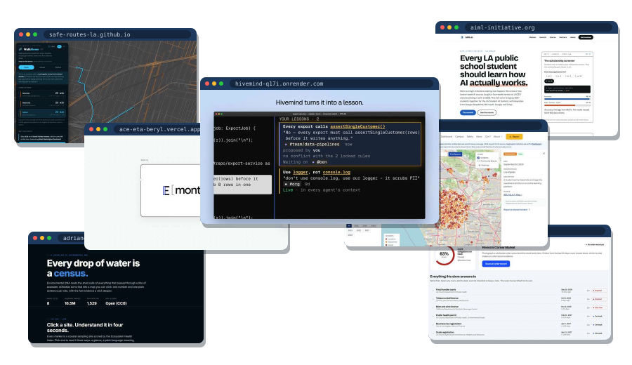

hi, i'm adrian. senior in los angeles.

mostly into ML and NLP research, especially evals: figuring out whether a model is actually good or just good on the test set. also into building small full-stack things people use, quant finance, startups, and AI in schools. i fence épée when i'm not at a laptop.

  

[adrianerlikhman.is-a.dev](https://adrianerlikhman.is-a.dev) · [linkedin](https://www.linkedin.com/in/adrian-erlikhman-78a262414)
